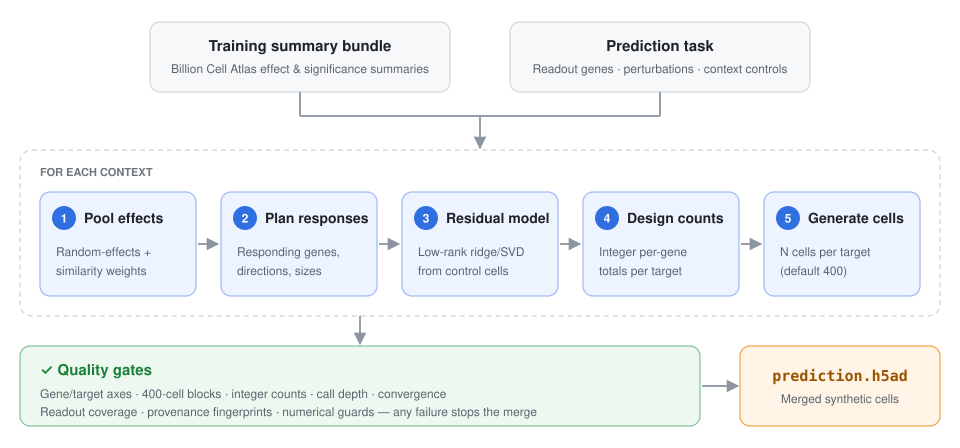

## CellularAI: Predicting single-cell responses to genetic perturbations

[](LICENSE)
[](pyproject.toml)

CellularAI is an algorithm designed to predict transcriptome-wide responses to genetic perturbations in unseen cell types and is the winning method of the [Virtual Cell Challenge 2026](https://virtualcellchallenge.org/leaderboard). Given control cells from a new cellular context and a list of genetic perturbations, it estimates how those cells respond to each perturbation and synthesizes non-negative integer-count single cells for every target.

The method is driven by precomputed training summary tables derived from the **[Illumina Billion Cell Atlas](https://www.illumina.com/areas-of-interest/genomics-in-drug-development/cell-atlas.html)**, together with public genome-scale CRISPRi Perturb-seq datasets in human induced pluripotent stem cells [[1](#references), [2](#references)] and primary human CD4⁺ T cells [[3](#references)]. This repository contains the prediction, validation, merging, and evaluation code. To access the Illumina Billion Cell Atlas and learn more about collaboration opportunities, email Illumina using the address BusinessDevelopment@illumina.com.

For an overview of the method and its results, see the release blog post, [Introducing the CellularAI algorithm](https://www.illumina.com/science/genomics-research/articles/introducing-the-cellularai-algorithm--predicting-single-cell-res.html).

### How it works

<p align="center">
  
</p>

For each context, CellularAI pools training summaries weighted by how similar their controls are to the new context, decides which genes respond to each perturbation, refines those effects with a control-conditioned residual model, and generates integer-count cells for each perturbation (400 per perturbation by default, set by `cells_per_perturbation` in the task YAML). A build is merged into `prediction.h5ad` only if every quality gate passes. The [method guide](docs/method.md) walks through each step.

### Installation

Requirements:

- Python 3.12
- Linux for parallel (multi-worker) stages; serial stages run anywhere Python does
- Enough memory and temporary storage for the control matrices and worker-shared arrays

Clone the repository and create the supplied [Mamba](https://mamba.readthedocs.io/) environment:

```sh
git clone https://github.com/Illumina/CellularAI.git
cd CellularAI
mamba env create -f env/environment.yml
mamba activate cellularai
python -m pip install -e '.[test]'
```

Alternatively, use a plain virtual environment:

```sh
python3.12 -m venv .venv
source .venv/bin/activate
python -m pip install -e '.[test]'
```

To reproduce the exact CPU environment used for reference validation, create the environment from `env/locked-cpu-environment.yml` instead; it pins the Python runtime and all transitive numerical libraries. Install CellularAI into it with `python -m pip install --no-deps .`.

Run the test suite from the repository root:

```sh
pytest
```

The tests generate fictional inputs at runtime and do not need a customer bundle.

### Synthetic example

This self-contained smoke test exercises the core pooling and single-process prediction path. It generates every input at runtime and needs neither external data nor network access. From the repository root, replace `OUTPUT` with a writable directory:

```sh
PYTHONPATH=src python examples/synthetic/run_example.py --output-dir OUTPUT
```

The example creates a fictional 30-gene task with three perturbations, control cells for two contexts, and a summary catalog with multiple primary views and an auxiliary entry, together with the required centering and variance estimates, checksums, model configuration, and task configuration. It then runs pooling and prediction for `context_A` and writes:

```text
OUTPUT/builds/ctx_context_A/predicted_cells_context_A.h5ad
```

Before reporting success, the script checks the gene and target axes, the context label, sparse non-negative integer counts, and equal-sized target blocks. The final matrix contains 1,200 cells across 30 genes and three targets.

This validates data flow and output consistency, not predictive accuracy or biological realism. Do not commit the generated inputs or outputs.

### Usage

A full run needs the separately supplied, access-controlled **summary bundle** (see above for how to request access), plus the task's gene list, perturbation list, and one control `.h5ad` file per context. See [Input files](docs/input-files.md) for the complete inventory.

1. **Place the supplied bundle**, for example at `run/customer_bundle`. Its entry point is `catalog.json`.

2. **Copy and edit the model configuration.**

   ```sh
   mkdir -p run
   cp configs/example.yaml run/config.yaml
   ```

   Set `training_data.catalog` in `run/config.yaml` to `customer_bundle/catalog.json` (relative paths are resolved from the config file) or to the catalog's absolute path. Keep the released `model` values unchanged and adjust `compute.workers` as needed.

3. **Prepare `run/task.yaml`** following the [task schema](docs/configuration.md#task-yaml). Relative control, gene, and perturbation paths are resolved from the task's `data_root`.

4. **Validate all inputs before computing.**

   ```sh
   cellularai preflight --config run/config.yaml --task run/task.yaml
   ```

   Preflight verifies summary SHA-256 checksums, catalog references, task exclusions, and every context control matrix.

5. **Run pooling, prediction, quality gates, and merging.**

   ```sh
   cellularai run --config run/config.yaml --task run/task.yaml --out run/output
   ```

   The local backend runs contexts sequentially; Slurm job generation is described in [Configuration](docs/configuration.md#local-and-slurm-execution). Use a fresh output directory: assembly refuses to overwrite an existing `prediction.h5ad`.

6. **Inspect the outputs.**

   ```text
   run/output/prediction.h5ad
   run/output/gates.json
   run/output/ctx_<context>/pooled_effects_<context>.npz
   run/output/ctx_<context>/predicted_cells_<context>.h5ad
   ```

   `prediction.h5ad` holds the accepted, merged, context-specific predictions, and `gates.json` reports every quality check. When scoring is requested, results are written separately to `run/output/score/scores.json`. See [Outputs and quality gates](docs/outputs.md).

#### Optional: packaging for the Virtual Cell Challenge

CellularAI writes only `.h5ad` predictions and JSON reports. To package a completed prediction as a `.vcc` submission file, install [vcc-cli](https://pypi.org/project/vcc-cli/) and run its `prep` utility with the gene and perturbation files from the VCC controls bundle:

```sh
vcc prep run/output/prediction.h5ad \
  -g run/task/gene_names.csv \
  --perts run/task/pert_counts.csv \
  -o run/output/prediction.vcc
```

This is a separate step; CellularAI does not invoke `vcc` or provide a submission command.

### Documentation

| Guide | Contents |
| --- | --- |
| [Method](docs/method.md) | Numerical description of pooling, planning, residual correction, count design, and cell synthesis |
| [Input files](docs/input-files.md) | Summary bundle, task, and evaluation bundle file contracts |
| [Configuration](docs/configuration.md) | Run, task, and evaluation YAML schemas; local and Slurm execution; individual stage commands |
| [Evaluation](docs/evaluation.md) | The public `vcc2025` harness: download, construction, scoring any method's predictions; metric definitions |
| [Outputs and quality gates](docs/outputs.md) | Output layout, file contents, and acceptance checks |
| [Reproducibility](docs/reproducibility.md) | Provenance fingerprints, input integrity, and numerical reproducibility |

### References

1. Nourreddine, S. *et al.* A genome-scale CRISPRi perturbation atlas of human induced pluripotent stem cells. *Nature Biotechnology* (2026). https://doi.org/10.1038/s41587-026-03199-w
2. Feng, C. *et al.* A genome-scale single-cell CRISPRi map of *trans* gene regulation across human pluripotent stem cell lines. *Cell Genomics* **6**, 101076 (2026). https://doi.org/10.1016/j.xgen.2025.101076
3. Zhu, R. *et al.* Genome-scale perturb-seq in primary human CD4+ T cells maps context-specific regulators of T cell programs and human immune traits. *Cell* **189**, 6988–7012.e17 (2026). https://doi.org/10.1016/j.cell.2026.08.002
4. Roohani, Y. H. *et al.* Virtual Cell Challenge: Toward a Turing test for the virtual cell. *Cell* **188**, 3370–3374 (2025). https://doi.org/10.1016/j.cell.2025.06.008

### License

CellularAI source code is provided under the [Apache License 2.0](LICENSE). The training summary bundle and other separately supplied data are access-controlled and governed by their own licenses and terms; the code license grants no rights to them. The public `vcc2025` evaluation bundle is derived from the Arc Institute's [Virtual Cell Challenge 2025 dataset](https://console.cloud.google.com/marketplace/product/bigquery-public-data/arc-institute?project=gcp-public-data-arc-institute) [[4](#references)] and is subject to its terms. Third-party notices are listed in [NOTICE](NOTICE).

### Contact

Core contributors:

- Aniketh Janardhan Reddy: areddy1@illumina.com
- Atreyo Pal: apal2@illumina.com
- Eyal Ben-David: ebendavid@illumina.com
- Kishore Jaganathan: kjaganathan@illumina.com
- Kyle Kai-How Farh: kfarh@illumina.com
